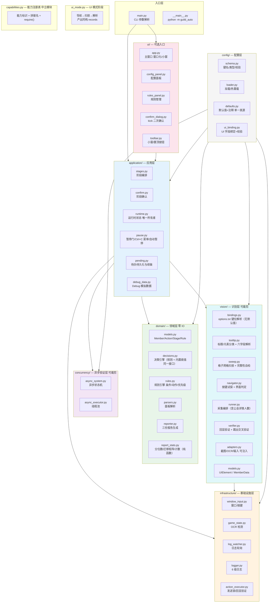
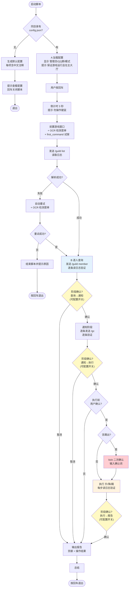
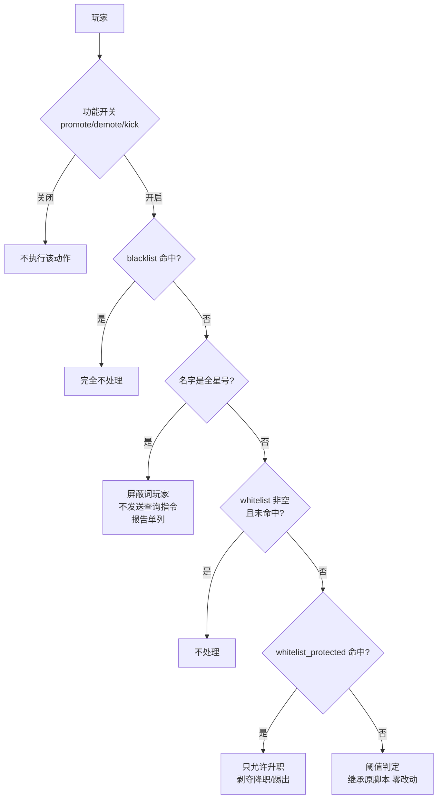
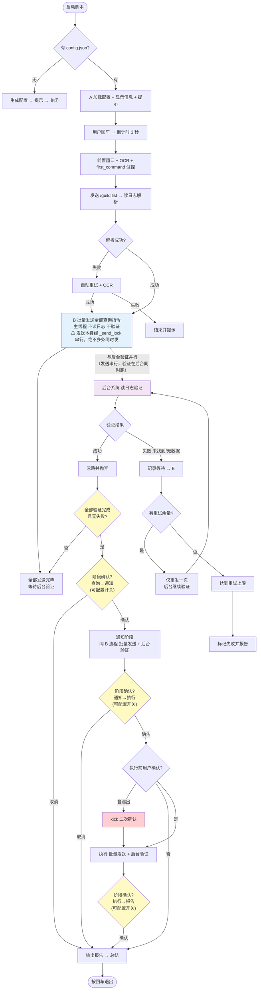
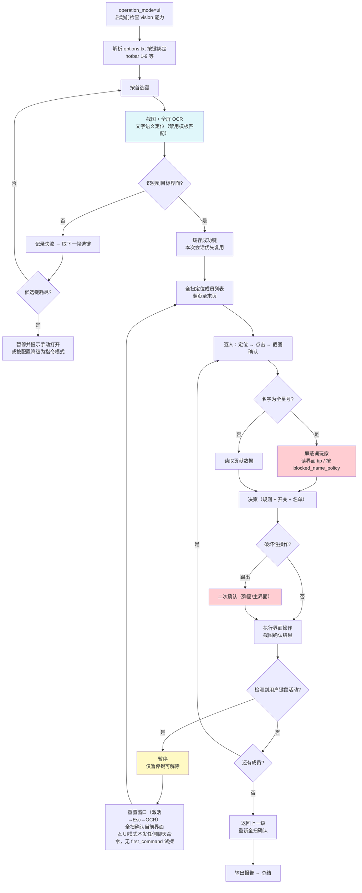
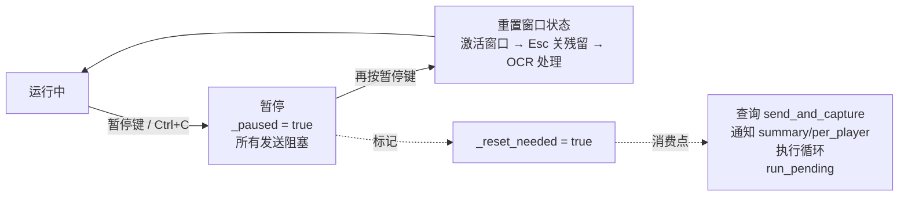
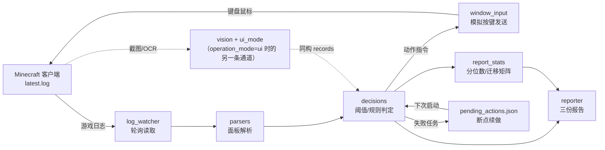

# 流程 & 架构图 — 布吉岛公会管理脚本

> 本文档覆盖两类内容：
> - **架构**：分层结构、依赖方向、模块归属、配置结构（第一、五、六节）
> - **流程**：默认/异步模式执行流程、暂停恢复、阶段确认点、数据流（第二、三、四、七节）
>
> 本文档描述**已落地的架构**（src-layout，迁移完成）。
> 代码与本文档不一致视为**文档缺陷**，与代码 bug 同等对待 —— 改架构或改流程必须同步改这里。
>
> 规格真源：`plan.txt` 第八节「结构化项目目录」与第四节「流程规格」。
>
> **与规格的已知偏差**（如实记录，未修复前不得当作已达标）：
> 1. `application/pause.py` 直接依赖 `pynput` / `pyautogui` 与 infrastructure 的
>    `game_state`、`window_input` —— 违反"application 不直接操作硬件"。
>    修复方向：监听器与 Esc 重置下沉到 infrastructure，application 只留状态机。
> 2. `application/runtime.py` 在方法内延迟 import `guild_auto.main`
>    （`reset_window_state_after_pause`），形成 application → 入口的反向边。
>    修复方向：改为延迟 import `application.pause` 的同名函数。
> 3. `domain/decisions.py`、`domain/reporter.py` 依赖 `infrastructure.logger`
>    做 trace/落盘 —— domain 声明为零 IO。修复方向：注入 trace 回调 / 拆出落盘。
> 4. `infrastructure/log_watcher.py` 在函数内延迟 import
>    `application.runtime.is_force_stop` —— 唯一的 infra → app 反向边。
>    修复方向：构造时注入 Ctrl+C 强停回调（与 `window_input` 的 stop_check 同范式）。
> 5. `application/pending.py`、`application/debug_data.py`、`infrastructure/action_executor.py`
>    不在规格目录树中，但按关注点归属到对应层（未合并进其它模块，避免回归风险）。

---

## 一、分层架构（依赖方向）



### 依赖规则（严格单向，禁止反向）

| 层 | 可依赖 | 禁止依赖 | 测试策略 | 构建变体 |
|---|---|---|---|---|
| `domain/` | 无（纯逻辑） | 任何层 | 单元测试，核心覆盖率 ≥98% | 必选 |
| `application/` | `domain/` | ui、infrastructure 具体实现 | 集成测试 | 必选 |
| `infrastructure/` | 标准库 / 三方库 | `application/`（只被调用） | mock 测试 | 必选 |
| `concurrency/` | 标准库 | `application/`（接口注入） | 单元测试 | 含 `async` 标识时 |
| `vision/` | `infrastructure/`（截图/OCR/按键） | `application/`（接口注入） | 单元测试 + OCR mock | 含 `vision` 标识时 |
| `ui/` | `application/` | `infrastructure/` | UI 测试 | 含 `gui` 标识时 |
| `config/` | 标准库 | 业务逻辑 | 单元测试 | 必选 |

> ⚠ **并发层目录必须命名 `concurrency/`，禁止 `async/`**
> —— `async` 是 Python 保留字，`from guild_auto.async import x` 会直接 `SyntaxError`。

---

## 二、默认模式（串行）流程



**核心语义**：发一条、验一条；验证不过不往下走。

---

## 二·五、判定优先级（阶段 5）



匹配规则：大小写不敏感；`match_wildcard=true` 时支持 `*` 与 `?`。
屏蔽词玩家（名字被网易过滤成整串 `*`）默认**不发送** `/guild member ***`——
该参数在网易服务器不会响应，发出去只白烧重试周期。

---

## 三、异步模式（后台）流程



**核心语义**：
- 主线程只发不验，验证全部由后台承担
- **必须等验证完成且无失败（或达重试上限）才进下一阶段**
- 重试仅重发一次，后台继续验证；⚠ 必须防死锁

> ⚠ **"并发"的确切含义（务必按此理解，写错会产出交叉输入的 bug）**
>
> 并发的只有"**发送**"与"**验证**"这两条流水线，**不是多条指令同时发送**：
> ```
> 主线程： 发1 → 发2 → 发3 → 发4 …（经 _send_lock 串行，一次只发一条）
>            ↘     ↘     ↘     ↘
> 后台：    验1   验2   验3   验4 …（读日志并行验证，不等前面验完）
> ```
> - **发送必须串行**：游戏只有一个聊天输入框，命令靠模拟键盘输入；
>   两条同时发会导致字符交织，产生 `/guild member 张三/guild member 李四` 这类乱码命令
> - `async.num_workers` 固定为 1，不得为了"提速"调大
> - 异步模式省掉的是「发一条等一条响应」的等待时间，不是靠并行发送
>
> 反例（禁止）：起多个线程同时调用 `human.send_chat_text()` 或绕过 `_send_lock` 直接发送。

---

## 三·五、UI识别模式流程（operation_mode = "ui"）

> 与指令模式二选一。共用配置/日志/暂停/报告/决策引擎/名单，仅"数据获取通道"与"动作执行通道"不同。
> 需构建含 `vision` 能力（`Lite-Vision` / `Lite-Async-Vision` / `Lite-Gui-Vision` / 全功能）。



**关键约束**：
| 约束 | 说明 |
|---|---|
| 禁止模板匹配 | 材质包会彻底改变图标外观；必须 OCR 文字语义定位 |
| 每次操作后重新全扫 | 禁止凭记忆断言当前界面 |
| 按键必须截图确认 | 禁止假设按键生效；连续误按超阈值则 Esc 回退 |
| 识别失败不盲点 | 走试探流程或暂停等人工 |
| 自动暂停 | 执行中用户任何键鼠活动即暂停；阶段确认/空闲/指令模式不触发 |

---

## 三·六、UI 配置界面（阶段 3）

```
main.py --ui ──► ui/app.py (tkinter)
                   ├── toolbar.py        小窗/大窗(◱/◰) + 置顶(📍/📌)
                   ├── config_panel.py   字段来自 config/ui_binding.flatten_config()
                   ├── confirm_dialog.py 踢出二次确认(逐字匹配确认词)
                   └── 保存 ──► config/ui_binding.apply_edits ──► schema.validate_config
                                                          └── loader.save_config
```

关键约束：
* 字段由 `DEFAULT_CONFIG` 摊平生成 → **新增配置键自动出现在 UI**，不硬编码字段表
* 校验分两层：单字段类型转换（严格，`"abc"` 不会静默变 0）+ 整体 `validate_config`
* `ui.enabled=false` 时 `--ui` **报错**，不静默降级到控制台
* 首次启动（配置刚生成）必须至少修改一项才能切页
* 热重载仅 UI 模式可用；命令行流程不依赖 ui/

---

## 三·七、自定义规则引擎（阶段 4）

```
decide_for_player(player, rank, weekly, cfg)
  ├── 名单短路(blacklist/whitelist/保护)        ← 优先级最高
  ├── rules_enabled=false → decide_actions(阈值) ← 改造前路径,零变化
  └── rules_enabled=true  → rules.evaluate_rules([自定义...] + [内置阈值作兜底])
                                                     ↓ strategy
                                          first_match / highest_priority / all
                                                     ↓
                                    (actions, hit_rule_ids, traces)
```

要点：
* **内置阈值规则 = 规则表里的一条规则**（`builtin_default_rule` 委托 `decide_actions`），
  不存在第二套判定逻辑
* 自定义规则排在**前面**、内置作兜底；`highest_priority` 时由 priority 决定
* `stop` 只在**命中后**生效（未命中不中断后续规则）
* 条件求值是纯函数零 IO；字段读不到一律判否（不当 0/真），并在 trace 写明原因
* 功能开关优先于规则：异步执行路径（`stage_execute_async`）已补开关门禁，
  关闭 kick 时自定义踢出规则也不会执行
* 语法错误启动即报错（`validate_rules`），指明 rule_id 与字段

---

## 四、关键行为（两模式共有）

### 阶段确认点（plan.txt 第六节第 9 条）

**每次阶段推进前必须等待用户确认**。共 6 个确认点，前 4 个为流程内置必有，后 3 个阶段边界确认点由配置开关统一控制：

| # | 确认点 | 位置 | 是否可配置 | 默认 |
|---|---|---|---|---|
| 1 | 启动前回车 | 显示配置信息后 | 否（流程必需） | 开启 |
| 2 | 执行操作前确认 | 判定完成、即将执行升/降/踢前 | 否（破坏性操作必需） | 开启 |
| 3 | kick 二次确认 | 执行阶段识别到踢出动作时 | 确认方式可配置（弹窗/主界面） | 弹窗 + 输入确认词 |
| 4 | 退出前回车 | 报告与总结输出后 | 否（流程必需） | 开启 |
| 5 | 阶段确认：查询 → 通知 | 逐人查询全部完成后 | **是**（配置开关） | 开启 |
| 6 | 阶段确认：通知 → 执行 | 通知全部完成后 | **是**（配置开关） | 开启 |
| 7 | 阶段确认：执行 → 报告 | 执行全部完成后 | **是**（配置开关） | 开启 |

**取消确认的后果**：跳过后续阶段，直接进入报告输出（已完成的数据与操作照常记录）。

**配置方式**：在 `config.json` 中统一设置确认粒度，例：
```jsonc
// 阶段确认开关：true=每个阶段推进前等待用户确认；false=自动连续推进（仅保留 1/2/3/4 四个必需确认点）
"stage_confirm": true
```

### 暂停 / 恢复



**规则**：每次暂停后继续 / 阶段确认后，必须重新做「与初次启动等效」的界面确认，**但两种操作模式的确认方式不同**：

| 操作模式 | 恢复后必须执行 | 说明 |
|---|---|---|
| `command`（指令模式） | 重置窗口（激活→Esc→OCR）→ **OCR 菜单检测 + first_command 试探** | `first_command` 是「直接往聊天框粘贴一条命令，试探聊天栏是否已打开」——只在指令模式有意义 |
| `ui`（UI识别模式） | 重置窗口（激活→Esc→OCR）→ **全扫确认当前界面** → 若不在目标界面则走按键试探重新进入 | ⚠ **不发任何聊天命令**，因此**没有 first_command 试探这一步** |

`_reset_needed` 不得残留到任何发送点（含 UI 模式的点击/按键动作）。

### 发送门控

```
所有游戏内发送必须经过 _send_with_gate:
    锁内串行  →  锁内暂停等待  →  恢复后先重置窗口  →  才发送
不允许任何绕过门控直接调用 HumanInput 的路径。
```

### OCR 防误判

```
多帧采样 + 关键词归一化(去空白) + 置信度阈值 + 缓存复用 + 降级为试探式发送
OCR 结果不得单独作为破坏性操作(升/降/踢)的唯一依据
```

---

## 五、终端可读版（ASCII）

```
┌─────────────────────────────────────────────────────────┐
│                        main.py                          │
│                   (CLI 参数解析 / 模式选择)              │
└────────────┬────────────────────────┬───────────────────┘
             │                        │
      ┌──────▼──────┐          ┌──────▼───────┐
      │    ui/      │          │ application/ │
      │ 窗口化/小窗  │─────────▶│  阶段编排     │
      │ 置顶/配置    │          │  确认/运行时  │
      └─────────────┘          └──────┬───────┘
                                      │
              ┌───────────────────────┼───────────────────────┐
              │                       │                       │
      ┌───────▼────────┐     ┌────────▼────────┐    ┌────────▼────────┐
      │   domain/      │     │ infrastructure/ │    │  concurrency/   │
      │ 决策/解析/报告  │     │ 窗口/OCR/日志    │    │ 异步状态机/线程池│
      │   (零 IO)      │     │   (可 mock)     │    │   (接口注入)    │
      └────────────────┘     └─────────────────┘    └─────────────────┘
                                      ▲
                              ┌───────┴────────┐
                              │    config/     │
                              │ 加载/校验/默认值│
                              └────────────────┘

依赖方向:  domain ← application ← ui
           infrastructure 被 application 调用(不反向)
           concurrency 独立，经接口注入
```

---

## 六、配置文件结构（config.json）

```
config.json (JSONC，每个键上方一行 // 中文注释)
├── admin / guild_qq                    人员信息
├── game_log / game_options / log_encoding   路径（game_options = 游戏实际写入的 options.txt）
├── window_keywords / chat_key / pause_key / guild_name
├── query_scope / kick_confirm / kick_confirm_text / skip_ranks
├── thresholds {}                       9 个升/降/踢阈值
├── delays {}                           6 个模拟人工延迟
├── timeouts {}                         6 个超时与重试
├── switches {}                         6 个功能开关 + notify_mode
├── stage_confirm {}                    阶段确认总开关 + 各边界确认点细分
├── blacklist [] / whitelist []         黑/白名单
├── whitelist_protected []              保护名单(永不踢出)
├── match_wildcard                      名单通配符匹配开关
├── blocked_name_policy                 屏蔽词策略: skip / query_attempt
├── rules_enabled / rules_strategy / rules []   自定义规则（条件/动作/优先级）
├── operation_mode                      操作模式: command(指令) / ui(界面识别)
├── vision {}                           UI 识别参数：hotbar_slot / stay_ms / sweep_gap_ratio /
│                                       low_confidence / max_misclick / kick_verify /
│                                       ocr_command / grid{origin_x,origin_y,cell_width,
│                                       cell_height,columns,rows,expected_cells,max_missing_ratio}
├── pause {}                            UI 自动暂停：auto_on_user_input / user_input_grace_ms
├── report {}                           第三份报告：analysis_enabled / include_config_snapshot /
│                                       include_daily_detail
├── state_check {}                      OCR 检测配置
├── commands {}                         5 个命令模板
├── notify_templates {}                 5 个通知文案
├── rank_names {}                       7 个等级名
├── report_dir / contact_text
├── error_patterns []
├── debug {}                            模拟数据配置
├── async {}                            异步验证层配置
├── log {}                              6 级日志配置
└── ui {}                               UI 入口：enabled / start_mode / always_on_top /
                                        kick_confirm_mode / kick_confirm_text
```

> 构建变体**不是配置项**：它由构建期的能力清单决定（见第八节），运行时只读展示，
> 因此不出现在 `config.json` 里。

**纪律**：业务数据（文案/命令/阈值/等级名）一律取自配置，代码中零硬编码；缺键直接抛错，禁止 `.get(key, "兜底值")`。

---

## 七、数据流（一次完整运行）



三份报告（`report.analysis_enabled=false` 时只出前两份）：

1. `<日期> <公会名>公会 所有玩家详细贡献.txt` —— 原脚本风格，群成员可读
2. `<公会名>_<日期>.txt` —— 群公告（升降踢名单）
3. `<日期> <公会名>公会 运行分析报告.txt` —— 七节诊断（元信息/阶段耗时/逐人决策/
   失败跳过/统计汇总/配置快照/全员名册对账，UI 模式加第六节），见 `docs/详细报告规范.md`

---

## 八、构建变体矩阵（能力可组合，非固定枚举）

变体 = **能力单元的任意子集**，不是固定几个。

### 能力单元

| 单元 | 标识 | 提供能力 | 依赖 | 可裁剪 |
|---|---|---|---|---|
| 核心 | `core` | 控制台流程 + 指令模式 + 决策/解析/报告 | 标准库 + 硬件库 | ❌ 必选 |
| 异步验证 | `async` | 后台并行验证（⚠ 发送经 `_send_lock` 串行，验证在后台并行；绝不多条指令同时发送） | threading | ✅ |
| 图形配置 | `gui` | 配置界面（窗口化/小窗/置顶/热重载） | tkinter（标准库） | ✅ |
| 界面识别 | `vision` | UI识别模式（OCR 全扫 + 按键试探） | OCR（可 mock） | ✅ |
| **…（可扩展）** | — | 未来单元（如 web 远程控制、多账号） | 按需 | ✅ |

> 上表是**开放式枚举**，不是封闭清单。新增能力单元只需定义标识 + 在依赖隔离点注册，
> 命名按固定位置追加，不得改名已有变体；构建矩阵由配置驱动而非硬写。

### 组合与命名

共 2³ = **8 种组合**，全部可构建：

| 能力组合 | 拼接名 |
|---|---|
| core | `Lite` |
| core + async | `Lite-Async` |
| core + gui | `Lite-Gui` |
| core + vision | `Lite-Vision` |
| core + async + gui | `Lite-Async-Gui` |
| core + async + vision | `Lite-Async-Vision` |
| core + gui + vision | `Lite-Gui-Vision` |
| core + async + gui + vision | `Lite-Async-Gui-Vision` |

**命名规则**：
- 拼接顺序固定：`async → gui → vision`（保证名字稳定可预测）
- 拼接名是**唯一权威标识**；可提供别名（如 `Full`）但产物/日志/artifact 一律用拼接名
- 新增能力单元时按固定位置追加，**不得改名已有变体**
- 构建矩阵由配置驱动（pyproject extras 或构建脚本能力表），禁止把 8 种组合硬写进 CI

### 能力可用性规则

| 情形 | 行为 |
|---|---|
| 变体缺该能力，配置未启用 | 配置项隐藏/置灰 |
| 变体缺该能力，配置强制要求 | **启动即报错**，禁止静默降级 |
| 例：`Lite` 中 `operation_mode="ui"` | 报错"当前构建不含 UI识别模式" |
| 例：`Lite` 中 `async.enabled=true` | 报错或按配置明确降级提示 |

启动横幅与报告必须写明：**当前构建拼接名 + 已启用能力清单**。

### 实现位置（与本图一致）

| 关注点 | 落点 |
|---|---|
| 能力注册表 / 拼接名 / `require()` | `src/guild_auto/capabilities.py` |
| 变体清单生成（喂给 CI matrix） | `scripts/build-variants.py --list` |
| 打包期能力常量（产物脱离 env 也能报出变体） | `scripts/build-variants.py --write-const` 生成 `guild_auto/_build_capabilities.py`（已 gitignore） |
| 启动门禁与横幅 | `main.py:prepare_config`（`capabilities.require`）+ `build_banner()` |
| 报告里的变体与能力 | `run_meta` 由 `capabilities.variant_meta()` 生成，与横幅同源 |
| CI 动态矩阵 | `.github/workflows/build.yml` 的 `variants` job |

---

## 九、与规格的对应关系

| 本图章节 | plan.txt 对应 |
|---|---|
| 一、分层架构 | 第八节 结构化项目目录 / 分层原则 |
| 二、默认模式 | 第四节【默认模式】 |
| 三、异步模式 | 第四节【异步模式】+【关键行为要求】 |
| 三·五、UI识别模式 | 【阶段 6】UI识别模式 |
| 四、关键行为 | 第六节 验收标准 5/8/9/13/14/20 + 【关键行为补充】自动暂停 |
| 五、ASCII | 第八节 |
| 六、配置结构 | 第四节 + 【阶段 5/6/7】新增配置项 + 项目纪律第 1/2 条 |
| 七、数据流 | 第四节 B 阶段 + 第五节 UI |
| 八、构建变体矩阵 | 【阶段 7】多构建变体 |
